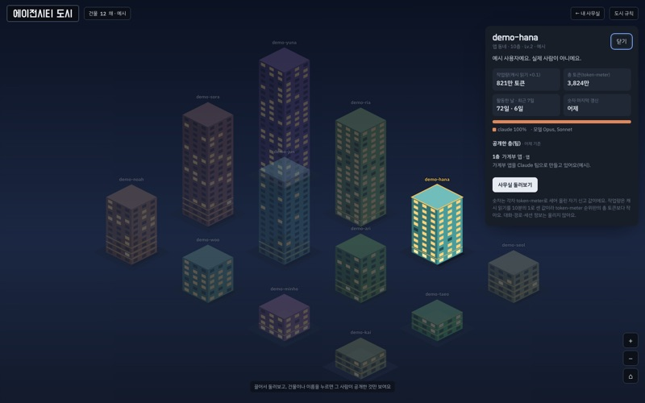

# 에이전시티 (Agencity)

**내 AI 에이전시를 꾸리고, 도시 위로 한 층씩 올려요.**

Claude Code 세션 여러 개를 **팀(팀장·개발자·디자이너·기획)** 으로 묶어 사무실처럼 보여 주고,
웹 페이지 하나에서 **누구에게나 말 걸기 · 회의 열기 · 결재**를 하는 로컬 대시보드예요.
원하면 내 사무실을 토큰 작업량만큼 높은 건물로 [에이전시티 도시](#에이전시티-도시-첫-버전)에 세워요.
지금은 Claude Code 세션을 팀에 앉히고, Codex·Gemini CLI는 앞으로 지원해요.

> English: **Agencity** — Run your AI agency. Raise it into the skyline.
> A local web dashboard that organizes several Claude Code desktop sessions into teams
> (lead, developer, designer, planner) shown as office floors; Codex and Gemini CLI support is planned.
> On macOS the installer also builds a small app (Agencity.app) on your Mac that shows the same page
> in its own window. A first-run setup signs in to GitHub (device code or the gh CLI), lists the Claude
> desktop app's Code sessions so you can turn projects into floors, and sets what each floor shows in
> the Agencity city, where every registered office becomes a building as tall as its token usage.
> From one page you can message any session, start meetings (attend or delegate), and approve decisions
> the team leads file. Messages are relayed by a coordinator session with Claude Code's own `SendMessage`
> tool — the page never injects input into sessions. UI text is Korean.


- 층(팀)마다 책상(세션 상태·하는 일), 회의실, 업무판, 활동 기록, 보고서가 보여요.
- 책상을 누르면 그 세션과 바로 대화해요. 답은 같은 화면에 올라와요.
- 회의는 사람(대표)만 열어요. **참석**(같이 대화)과 **위임**(팀끼리 하고 회의록·결재로 보고)이 있고, 중간에 빠지면 남은 안건은 팀이 이어서 해요.
- 팀장이 올린 **결재**를 결재함에서 고르면 그 팀장에게 바로 전해져요.
- 맥에서는 브라우저 대신 앱 창(**Agencity.app**)으로 열 수 있어요. 처음 켜면 설정 화면에서 몇 가지만 고르면 돼요.
- 파일만 읽고 쓰는 단순한 구조예요(Python 표준 라이브러리 + 정적 HTML, 맥 앱은 이 맥에서 직접 컴파일하는 Swift 파일 하나).

## 이름이 바뀌었어요

예전 이름: 클로드 오피스(Claude Office). v0.3.1까지 이 이름이었고, v0.4.0부터 에이전시티예요.
Codex·Gemini CLI도 함께 쓰게 될 거라 에이전트(agent)·에이전시(agency)·도시(city)를 합쳐 이름을 바꿨어요.

- 저장소는 [Min-heee/agencity](https://github.com/Min-heee/agencity)예요. 예전 저장소 주소와 설치 링크는 GitHub가 새 주소로 넘겨 줘요.
- 기본 설치 폴더는 `~/agencity`예요. 예전 한 줄 설치로 받은 `~/claude-office`가 있으면(git 폴더가 아닐 때) 같은 한 줄을 다시 실행해서 그 폴더를 그대로 새 버전으로 바꿔요. 팀 정보도 그대로 둬요.
- 설치할 때 쓰는 이름=값은 `AGENCITY_…`로 바뀌었어요. 예전 글에 있던 `CLAUDE_OFFICE_DIR`·`CLAUDE_OFFICE_REF`는 설치 스크립트가 아직 받아 줘요.
- 도시에 올리는 파일은 `agencity.json`이에요. 예전 판이 올린 `claude-office.json`도 도시가 읽고, 새 판으로 다시 올리면 그 파일은 지워요.

> Formerly Claude Office (until v0.3.1). Old GitHub links redirect to Min-heee/agencity.

## 설치하고 켜기 (macOS·Linux)

**한 줄로** — 터미널에 붙여 넣으면 `~/agencity`에 설치하고 바로 켜요:

```bash
curl -fsSL https://raw.githubusercontent.com/Min-heee/agencity/main/install.sh | sh
```

**맥 앱** — 맥에 Xcode 명령어 도구(`swiftc`)가 있으면 설치하면서 이 맥에서 앱을 직접 만들어
`~/Applications/Agencity.app`에 두고, 브라우저 대신 그 앱으로 열어요. 명령어 도구가 없으면(그리고 리눅스는) 브라우저로 켜요.

- 서명 계정은 필요 없어요. 이 맥에서 만든 앱이라 그대로 열려요(임시 서명만 해요).
- 다음부터는 응용 프로그램 폴더나 Spotlight에서 **Agencity**를 열어요.
- 창을 닫아도 사무실 서버는 켜져 있어요(Dock 아이콘을 누르면 창이 다시 떠요). 끄려면 앱에서 **⌘Q**.
- 앱에는 설치 폴더 경로가 들어가요. 설치 폴더를 옮기면 새 위치에서 앱을 다시 만들어요: `sh <새 폴더>/bin/make_mac_app.sh --open`.
- 나중에 앱으로 쓰려면: `xcode-select --install`로 명령어 도구를 설치한 뒤 `sh ~/agencity/bin/make_mac_app.sh --open`.
- 설치할 때 고를 수 있는 것(`... | 이름=값 sh`):
  - `AGENCITY_NO_APP=1`: 앱을 만들지 않고 예전처럼 브라우저로 켜요.
  - `AGENCITY_APP_DEST=<폴더>`: 앱을 `~/Applications` 대신 그 폴더에 만들어요(`make_mac_app.sh`도 같은 값을 써요).
  - `AGENCITY_NO_START=1`: 설치만 하고 켜지 않아요(앱도 만들지 않고 만드는 명령만 알려 줘요).

**내려받아서** — [Releases](https://github.com/Min-heee/agencity/releases/latest)에서 소스 zip을 받아 풀고,
맥은 `Agencity.command`를 더블클릭해요(명령어 도구가 있으면 앱을 만들어 앱으로 열고, 없으면 브라우저로 켜요).
처음 한 번은 "확인되지 않은 개발자"라며 막힐 수 있어요.
그럴 땐 **시스템 설정 → 개인정보 보호 및 보안**의 아래쪽에서 **그래도 열기**를 누르거나(예전 macOS는 오른쪽 클릭 → **열기**),
터미널에서 그 폴더로 가서 `python3 start.py`로 켜요. 리눅스도 `python3 start.py`.

**git으로**:

```bash
git clone https://github.com/Min-heee/agencity.git && cd agencity && python3 start.py
```

git으로 받은 폴더에서도 맥 앱을 쓰려면 `sh bin/make_mac_app.sh --open`.

- 처음 켜면 [처음 설정](#처음-설정) 화면이 떠요. ‘나중에 하기’를 누르면 예시 팀으로 열려요.
  브라우저로 켰다면 다음에도 `python3 start.py`(또는 더블클릭)만 하면 돼요. 끄려면 그 창에서 Ctrl-C(앱은 ⌘Q).
- 8765 포트가 쓰이고 있으면 다음 빈 포트로 켜고 주소를 알려 줘요. 이 폴더의 사무실이 이미 켜져 있으면 그 페이지를 열어요.
  전달 감시기(`bin/relay_watch.py`)는 서버가 `outbox/.port`에 적어 둔 포트를 스스로 찾아요.
- **새 버전 받기**: 한 줄 설치로 받았다면 같은 줄을 다시 실행해요. 코드만 새로 받고 내 팀 정보(`org.json`, `teams/`, `hq/`,
  `outbox/`, `public.json`, `agencity.json`, `setup.json`)는 그대로 둬요. 맥 앱은 새로 만들어 다시 열어요.
  브라우저로 켜 둔 사무실은 Ctrl-C로 끄고 다시 켜야 새 버전이 적용돼요.
  git으로 받았다면 `git pull`(한 줄 설치는 git 폴더를 덮어쓰지 않아요).
  zip으로 받았다면 처음에 폴더를 한 곳(예: `~/agencity`)에 두고 계속 써요. 팀 규칙 파일에 그 폴더 경로가 들어가서,
  새 zip을 다른 폴더에 풀면 팀 정보가 따라가지 않아요. 그 폴더에 새 버전을 받으려면
  `curl -fsSL https://raw.githubusercontent.com/Min-heee/agencity/main/install.sh | AGENCITY_DIR=<그 폴더> sh`.
- 필요한 것: 파이썬 3.9 이상(맥은 기본 또는 `xcode-select --install`), `jq`(사이트 메시지 전달과 팀원 답장에 필요,
  맥 `brew install jq`, 리눅스 `sudo apt install jq`), Claude Code 데스크톱 앱. 맥 앱을 만들려면 Xcode 명령어 도구(macOS 12 이상).
  다른 패키지는 없어요.
- 예시 팀을 써 보면 `examples/teams/demo/`에 기록이 남아요. 지우려면 git으로 받았을 땐 `git checkout examples/ && git clean -fdx examples/`,
  아니면 설치 폴더에서 `rm -rf examples/teams/demo/chat/*.jsonl examples/teams/demo/meetings/*-M-* examples/teams/demo/.out` 뒤 설치를 한 번 더 해요.

## 처음 설정

처음 켜면 설정 화면이 다섯 단계로 떠요. 나중에 사무실 위쪽의 **설정**을 누르면 언제든 다시 열어요.
설정은 설치 폴더의 `setup.json`(GitHub 아이디·공개 범위, 토큰은 없음)에, 층은 `org.json`·`teams/`에, 공개 범위는 `public.json`에도 적어요.
모두 내 정보라 다시 설치해도 그대로 둬요.

1. **로그인(GitHub)** — 도시에 올릴 때만 필요해요. 사무실은 로그인 없이도 다 돼요(‘로그인 없이 쓰기’).
   - **GitHub로 로그인**: 화면에 나온 코드를 복사해 `github.com/login/device`에 넣고 승인해요. 받는 권한은 gist 하나예요.
     토큰은 이 맥의 `~/.config/agencity/github-token.json`(나만 읽을 수 있는 0600 파일)에만 두고 화면이나 응답에는 내지 않아요.
   - **gh(GitHub CLI) 로그인 쓰기**: 터미널에서 `gh auth login`을 해 뒀다면 그 계정으로 연결해요. gh의 토큰은 읽거나 따로 저장하지 않아요.
2. **Claude 연결** — Claude는 **따로 로그인하지 않아요.** 이 맥의 Claude 데스크톱 앱이 저장해 둔 Claude Code 세션 목록
   (제목·폴더·마지막 활동)만 읽어요. 대화 내용은 읽지 않아요.
3. **사무실 만들기** — 프로젝트(폴더) 하나가 층(팀) 하나예요. 층으로 만들 프로젝트를 고르고, 층 이름·팀 id를 정하고,
   팀장·개발자·디자이너·기획 자리마다 그 프로젝트의 세션을 골라 앉혀요(비워 둬도 돼요). 총괄(코디네이터) 세션도 여기서 골라요.
   하는 일은 `python3 bin/new_team.py`와 같아요.
4. **공개 범위** — 층마다 비공개(기본)·건물만·층 이름·둘러보기 중에서 골라요. 건물(높이·등급·창문 불빛)은 여기서 고른 것과
   상관없이 token-meter 숫자로 서고, 실제로 나가는 층 정보는 ‘층 이름’과 ‘둘러보기’뿐이에요. 프로필 소개 한 줄은 층과 상관없이 함께 나가요.
   - **저장**은 이 맥에만 적어요. **도시에 올리기**를 누르면 나갈 내용을 한 번 더 보여 주고, 확인하면 내 token-meter gist에 올려요.
   - 올린 뒤 모든 층을 비공개(또는 건물만)로 바꾸면 버튼이 **도시에서 내리기**로 바뀌어요. 층 정보를 비운 요약을 올려서 도시에서 내려요.
     다만 gist 수정 기록에는 예전 판이 남을 수 있어요.
   - 화면에 ‘아직 도시에 올리지 않았어요’나 ‘도시에는 예전 내용이 올라가 있어요’가 보이면 저장한 설정이 아직 도시에 반영되지 않은 거예요.
5. **완료** — 고른 것을 정리해 보여 주고 사무실을 열어요. 새로 만든 층의 프로젝트마다 `CLAUDE.local.md`에 넣을 한 줄도 여기서 복사해요.

### 관리자 메모: GitHub 기기 코드 로그인

설치 폴더의 `github_client_id`가 비어 있으면 ‘GitHub로 로그인’(기기 코드)은 꺼져 있고 gh 로그인만 보여요.
켜려면 GitHub의 **Settings → Developer settings → OAuth Apps**에서 앱을 하나 만들고 **Enable Device Flow**를 켠 뒤,
그 **Client ID**를 이 파일 첫 줄에 넣어 함께 배포해요. Client ID는 공개해도 되는 값이고 client secret은 필요 없어요.
시험할 때는 파일 대신 `AGENCITY_GITHUB_CLIENT_ID` 환경 변수로 넣을 수도 있어요.

## 에이전시티 도시 (첫 버전)



등록한 사람마다 **토큰 작업량만큼 높은 건물**이 하나씩 서는 도시예요. 건물을 누르면 카드가 열리고,
주인이 공개한 층(팀)만 **읽기 전용**으로 둘러볼 수 있어요.

- 열기: 사무실 위쪽 **도시 보기 →**, 또는 `http://127.0.0.1:8765/city.html` (예시 도시는 `city.html?demo=1`).
  `city.html`은 정적 파일이라 GitHub Pages 같은 곳에 그대로 올려도 돼요.
- 건물 데이터: [token-meter](https://github.com/Min-heee/token-meter) 명단(members.json)과 각자의 공개 gist를 읽어요.
  - 높이 = 작업량(총 토큰 − 캐시 읽기 + 캐시 읽기 × 0.1)의 로그 눈금, 1~40층
  - 창문 불빛 = 최근 7일 중 활동한 날, 금빛 띠 = 공개한 층(팀)
  - 다른 명단을 쓰려면 `org.json`에 `"city": {"registry": "https://…/", "me": "<내 아이디>"}`
- 내 층 공개하기(기본은 아무것도 공개 안 함): 앱의 **설정 → 공개 범위**에서 고르고 **도시에 올리기**를 눌러요([처음 설정](#처음-설정)).
  터미널로 하려면:
  1. `public.example.json`을 `public.json`으로 복사해서 공개할 층만 적어요. 업무판 제목(`board`)과 책상의 지금 하는 일(`tasks`)은 따로 켜야 나가요.
  2. `python3 bin/office_public.py`로 **미리보기** — 경로·주소·메일·전화번호·키 모양 값·인용은 지우거나 그 줄을 빼요.
  3. 괜찮으면 `python3 bin/office_public.py --publish` — 내 token-meter gist에 `agencity.json`으로 올려요(한 번 더 확인, gist 주인 확인).
- 숫자는 각자 신고한 값이라 검증할 수 없어요. 도시에는 '자기 신고'라고 표시해요.

## 앞으로의 계획: 에이전시티 도시

사람마다 자기 사무실을 등록하면, **토큰 사용량만큼 높은 빌딩**이 하나씩 서는 도시를 만들려고 해요
([Git City](https://github.com/srizzon/git-city)에서 영감). 건물의 층은 그 사람의 팀이에요.
건물을 누르면 그 사람이 **공개해 둔 층만** 읽기 전용으로 들여다보고 둘러볼 수 있어요.
기본은 비공개이고, 대화·결재·보고서 원문은 공개하지 않아요. 토큰 숫자는
[token-meter](https://github.com/Min-heee/token-meter)가 내 컴퓨터에서 세서 본인이 원할 때만 올려요.
자세한 내용: [docs/VISION.md](docs/VISION.md)

## 어떻게 동작하나요

```
브라우저나 맥 앱 창(127.0.0.1:8765)
   │  POST /api/say · /api/meeting/* · /api/decide   (Host·Origin·열쇠 확인)
   ▼
office_server.py ──► 팀 사무실 파일에 기록 (chat/*.jsonl, meetings/*, approvals/*, log.jsonl)
   │
   └─► outbox/<id>.json  (전달할 메시지, 서버가 만든 것만 등록)
            │
            ▼
총괄(코디네이터) Claude Code 세션 ── Monitor로 bin/relay_watch.py 실행
            │   RELAY <파일> 알림을 받으면
            ▼
      SendMessage(to=세션 id, 내용 그대로)  ──►  팀 세션
                                                   │ 답은 Write로 .out/<역할>.txt에 쓰고
                                                   ▼
                                         bin/say.sh <대화 파일> <역할> --file …
                                                   │
                                                   ▼
                                    대화 파일 → 브라우저가 몇 초마다 다시 읽어 보여 줌
```

왜 세션에 직접 넣지 않나요? 세션의 메시지 소켓에 외부 프로그램이 사용자 입력처럼 글을 넣는 방식은
Claude Code의 자동 모드 안전장치가 막아요. 그래서 공식 도구인 `SendMessage`로만 전해요.
사이트에서 온 말은 다른 세션을 거친 메시지라 **승인(커밋·배포·결제 등)으로 쓰이지 않아요.**
위험한 일은 결재로 "하기로 정함"까지만 하고, 실제 실행은 그 세션 창에서 사람이 마지막으로 확인해요.

## 내 팀 꾸리기

설정 화면의 **사무실 만들기**에서 고르는 게 가장 쉬워요. 터미널에서는:

```bash
python3 bin/new_team.py
```

팀 id·이름·프로젝트 폴더·역할별 세션 id(모르면 비워 둬도 돼요)를 물어보고, `<프로젝트>/.office/` 팀 사무실과
`teams/<id>` 연결, `org.json`의 다음 층을 한 번에 만들어요. 팀 사무실에는 `.gitignore`(`*`)를 둬서 팀 기록이 커밋되지 않게 해요.
끝나면 `@.office/RULES.md` 한 줄을 프로젝트의 `CLAUDE.local.md`에 넣으면 그 프로젝트의 세션들이 팀 규칙을 읽어요.
세션 id(`local_…`)는 각 세션에서 "이 세션 id 알려 줘"라고 물으면 돼요.

사이트에서 보낸 말을 팀 세션에 전하려면 총괄(코디네이터)로 쓸 세션 하나에서 [docs/COORDINATOR.md](docs/COORDINATOR.md)대로 전달을 켜요.
손으로 꾸리고 싶다면 `examples/teams/demo/` 구조와 [docs/TEAM_RULES.md](docs/TEAM_RULES.md)를 참고하세요.

## 보안 메모

- 서버는 `127.0.0.1`에만 열려요. `Host`·`Origin`·페이지 열쇠(서버를 켤 때마다 새로 만듦)·JSON만 받는 요청만 처리해요.
- 다른 사이트가 이 페이지를 틀(iframe)에 넣지 못하게 `X-Frame-Options: DENY`, `frame-ancestors 'none'`을 보내요.
- 보여 주는 파일은 `index.html`, `org.json`, `hq/`, 등록된 팀 사무실 폴더 안으로 제한해요. 링크로 된 팀 사무실(`.office`)은 층으로 받지 않고,
  로그인 토큰이 있는 `~/.config/agencity/`는 어떤 경로로 와도 보여 주지 않아요.
- GitHub 토큰(기기 코드 로그인)은 `~/.config/agencity/github-token.json`(0600)에만 두고 페이지나 응답, `setup.json`에는 넣지 않아요.
  Claude 세션 기록에서는 세션 id·제목·폴더·마지막 활동만 읽어요.
- 전달 항목은 서버가 만든 것만 코디네이터가 보내요(`/api/outbox/check`로 내용 해시 확인). 1분 30개, 대기 40개로 양을 제한해요.
- `bin/say.sh`는 정해진 대화 파일에만, `대표` 이름이 아닌 것만 쓸 수 있어요.
- 남는 위험: 같은 맥의 다른 프로그램(에이전트 포함)은 페이지를 받아 열쇠를 읽을 수 있어요. 그래서 사이트 메시지를 승인으로 쓰지 않는 규칙이 중요해요.
- `python3 build.py --snapshot`은 팀 상태를 페이지 안에 담아 공유용 `artifact.html`을 만들어요. **팀 데이터가 그대로 들어가니** 공개하기 전에 꼭 확인하세요.

## 한계

- 지금은 Claude Code 세션만 층에 앉힐 수 있어요. Codex·Gemini CLI는 앞으로 지원해요.
- 코디네이터 세션이 켜져 있어야 전달돼요(끊기면 화면 위에 "총괄 연결 끊김").
- Claude Code는 한 세션이 사람 입력 없이 다른 세션에 메시지를 많이 보내면 잠깐 막아요. 팀장이 그 한도에 걸리면 그 팀장 창에 사람이 한 번 입력해야 풀려요. 사이트로는 풀 수 없어요.
- 화면 글은 한국어예요.

## 라이선스

[MIT](LICENSE)
