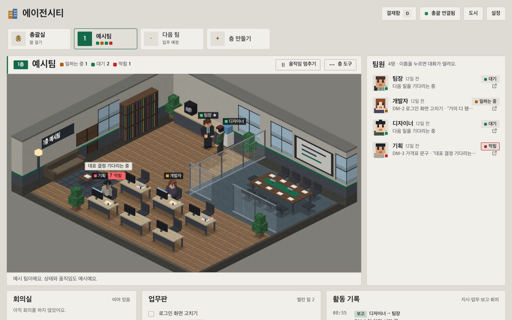
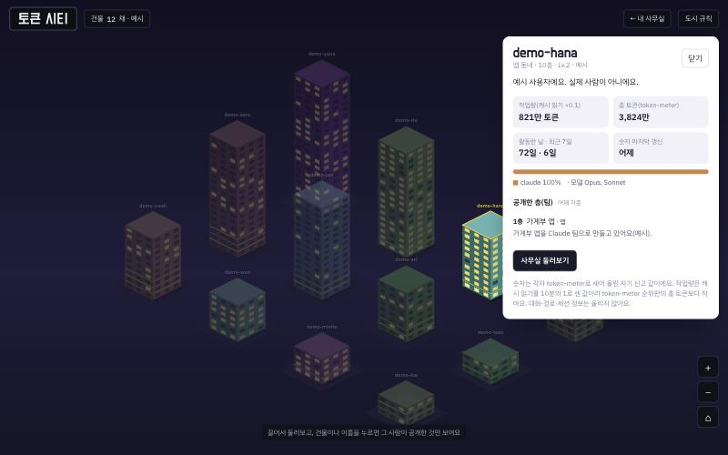

<div align="center">

# 에이전시티 (Agencity)

**내 AI 에이전시를 꾸리고, 도시 위로 한 층씩 올려요.**

Claude Code 세션들이 팀이 되어 사무실 한 층에서 움직여요.<br>
일할 땐 책상에 앉고, 회의가 열리면 회의실로 걸어가고, 일을 기다릴 땐 커피를 마셔요.<br>
한 화면에서 말 걸고 회의하고 결재해요.

[설치](#설치) · [처음 켜면](#처음-켜면) · [사용 안내서](docs/GUIDE.md) · [English](#english)

</div>



## 이런 걸 해요

- **연결하면 추천 팀을 만들어 줘요**: Claude·Codex 세션 목록을 훑어 층마다 팀을 추천해요. 보고 고친 뒤 한 번에 만들어요.
- **한눈에 보기**: 층마다 사무실 장면과 팀원 명단이 있어요. 사람들이 실제 상태대로 움직이고, 명단에는 세션 상태와 하는 일이 떠요. 회의실·업무판·보고서도 한 화면에 있어요.
- **팀은 내 마음대로**: 세션을 팀장·팀원 자리에 앉히고, 역할 이름은 직접 지어요. 빈자리는 **세션 만들기**로 바로 채워요.
- **바로 대화**: 사람이나 명단의 이름을 누르면 그 세션과 대화해요. 답도 같은 화면에 올라와요. 사진도 주고받아요.
- **회의**: 내가 같이 하거나(참석), 팀에 맡기고 회의록으로 받아요(위임).
- **결재**: 팀장이 올린 결재를 결재함에서 고르면 그 팀장에게 바로 전해져요.
- **팀끼리**: 팀장끼리 다른 층과 이야기해요. 주고받은 말은 화면의 **팀 간 대화**에 남아요.
- **직원 스킬 (시험 기능)**: 층마다 켜면 세션 없는 직원을 둬요. 직원 스킬(`SKILL.md`) 하나가 직원 하나이고, 팀장 세션이 일꾼으로 띄워요. 이 층 스킬이나 Claude 공식 플러그인 일꾼 하나를 골라 직원으로 들여요(남이 쓴 글은 팀장 창 승인을 거쳐요). 기본은 꺼져 있어요. [자세히](docs/GUIDE.md#직원-스킬-시험-기능)

Claude Code와 함께 써요. Codex 세션은 읽기 전용 자리로 앉혀 하는 일을 봐요(말 걸기는 아직 안 돼요). Gemini CLI는 앞으로 지원해요.

## 설치

맥 터미널에 붙여 넣어요. `~/agencity`에 설치하고 바로 켜요.

```bash
curl -fsSL https://raw.githubusercontent.com/Min-heee/agencity/main/install.sh | sh
```

- **필요한 것**: 맥, Claude Code 데스크톱 앱, 파이썬 3.9 이상, `jq`. 말 걸기·회의·결재·세션 만들기는 맥의 Claude 데스크톱 앱이 있어야 해요.
- **맥 앱**: Xcode 명령어 도구(`xcode-select --install`)가 있으면 Agencity 앱 창으로 열려요. 명령어 도구 없이 쓰려면 python.org 파이썬을 깔아요(브라우저로 열려요).
- **리눅스**: 예시 팀과 Codex 읽기 전용 층만 돼요.
- **업데이트**: 새 버전이 나오면 화면 위에 알림이 떠요. **업데이트**를 누르면 팀 정보는 그대로 두고 코드만 새로 받아요.

zip·git으로 받기와 설치 옵션은 [사용 안내서](docs/GUIDE.md#설치)에 있어요.

## 처음 켜면

1. **사무실 만들기 화면이 떠요.** 이 맥의 Claude·Codex 세션으로 층마다 팀을 추천해 줘요. 줄을 펼쳐 보고 고칠 건 고쳐요. 직접 고르기도 그 아래에 있어요. 먼저 둘러보려면 **예시 팀 먼저 보기**를 눌러요.
2. **사무실을 열어요.** **사무실 열기 · 층 n개**를 누르면 층이 생겨요. **팀 규칙 줄 넣기**(기본 켬)를 둔 채면 층 폴더의 `CLAUDE.local.md`에 한 줄을 넣어 팀 세션들이 팀 규칙을 읽어요.
3. **총괄을 켜요.** **총괄 세션도 열기**(기본 켬)를 둔 채 열면 Claude 앱에 총괄 창이 떠요. 작성창의 글을 읽고 Enter만 눌러요. 화면에서 보낸 말을 이 세션이 팀에 전해 줘요. 손으로 하려면 [이 지시](docs/COORDINATOR.md)를 붙여 넣어요.

Claude는 따로 로그인하지 않아요. GitHub 로그인·도시 공개·알림은 원할 때 사무실 위쪽 **설정**(층·총괄·도시·알림)에서 해요. [자세한 설명 →](docs/GUIDE.md#처음-설정)

## 에이전시티 도시



등록한 사람마다 **토큰 작업량만큼 높은 건물**이 서요. 건물을 누르면 주인이 공개한 층만 읽기 전용으로 둘러봐요.

- 사무실 위쪽 **도시**로 열어요.
- 설치하지 않은 사람도 [min-heee.github.io/agencity](https://min-heee.github.io/agencity/)에서 봐요.
- 기본은 비공개예요. GitHub에 연결한 뒤 **설정 → 도시**의 **도시에 내 건물 세우기**에서 내 숫자를 올리고 [도시 명단](https://github.com/Min-heee/token-meter)에 참가해요. 층과 나라도 같은 화면에서 골라요.
- 건물은 본인이 고른 나라 구역에 서요. **[빌딩 | 숫자]**로 총 토큰 순위표(오늘 숫자 함께)를 보고, **[한국어 | English]**로 화면 글을 바꿔요.
- 에이전시티를 깔지 않아도 공개 도시의 **내 건물 세우기 →**에서 만든 명령 한 줄로 숫자(와 고른 나라)만 올려 건물을 세울 수 있어요. 올리기 전에 한 번 더 물어봐요.

[도시 안내](docs/GUIDE.md#에이전시티-도시) · [앞으로의 계획](docs/VISION.md)

## 안전하게

- 내 컴퓨터(`127.0.0.1`)에서만 열려요. Claude·Codex에서는 세션 목록(제목·폴더·그룹·마지막 활동)과 Claude 세션의 실행 상태만 읽어요. 세션이 30분 넘게 일하는 상태면 대화 기록(`~/.claude/projects`)의 고친 시각도 봐요. 이때 글은 꺼내지 않아요. 직원을 둔 층은 팀장 세션의 일꾼 기록에서 종류 이름·끝 표시·고친 시각만 꺼내요. 허락하면 추천 팀을 위해 세션마다 첫 메시지 앞부분에서 역할 낱말만 찾아요. 세션 만들기·총괄 만들기로 기다리는 동안(30분까지)은 그사이 새로 만든 세션의 첫 메시지에서 자리 표시만 찾아요. 이 맥 안에서만 보고, 저장하거나 AI에 보내지 않아요. 스킬로 직원을 들일 때는 이 층 스킬과 이 맥의 Claude 공식 플러그인 사본(`~/.claude/plugins/marketplaces/claude-plugins-official`)의 일꾼 글을 읽고(양식을 펼 때 머리말, 카드를 펼 때 본문), 직원을 둔 층은 팀장 폴더 설정(`.claude/settings*.json`)의 hooks 칸 해시와 `.claude/agents/`의 파일 이름도 봐요. 들인 글은 직원 폴더에 옮겨지고, 팀장이 그 직원을 띄우면 Claude로 가요. 이 맥 안 읽기로는 바깥 요청이 늘지 않아요.
- 직원 스킬을 켠 층에서 **스킬 찾기에 skills.sh 쓰기**(기본 꺼짐)를 켜면, **찾기**를 누를 때만 화면에 보이는 영어 낱말 1~4개가 skills.sh(Vercel)로 가고, 찾은 줄을 눌러 카드를 열 때와 **다시 읽기**·**직원 들이기**를 누를 때만 그 스킬 파일을 GitHub에서 로그인 없이 받아요. 두 곳 모두 이 맥의 인터넷 주소(IP)를 봐요. 맡길 일 글·역할 이름·팀 이름·스킬 내용은 보내지 않아요. 설치 수는 참고일 뿐 안전하다는 뜻이 아니에요.
- 대화에 붙인 사진은 세션이 열면 Claude로 보내지고 세션 기록에 남아요. 지워도 그 사본은 남아요. 위치 정보는 지우지 않아요.
- 화면에서 보낸 말은 승인으로 쓰이지 않아요. 커밋·배포·결제는 그 세션 창에서 내가 직접 확인해요.
- 도시에는 내가 확인한 것만 올라가요. 대화·결재·보고서 원문은 올리지 않아요.
- 내 건물을 세울 때는 Claude·Codex·Gemini 로그에서 숫자(토큰·횟수·환산액)·모델 이름·날짜만 세요(대화 글은 꺼내지 않아요). 올라가는 건 이 내용과 나라·시간대뿐이고, **gist에 올리기**를 누를 때(켜 둔 자동으로 올리기는 1시간마다, 숫자가 바뀌었을 때만)만 나가요. 고른 나라는 공개 gist에 올라가고, 시간대는 나라와 따로 늘 올라가요. 그만두려면 [탈퇴 이슈](https://github.com/Min-heee/token-meter/issues/new?template=leave.yml&title=leave)를 열고 gist를 지워요.
- 사용량 알림(기본 꺼짐)을 켜면 같은 로그에서 토큰 수·시각·작업 폴더만 이 맥 안에서 세요. 아무것도 보내지 않고, 끄면 읽지 않아요. 한도를 정하면 그 한도에서 남은 양(%)이 층 머리글에 보여요.

[보안 자세히 보기 →](docs/GUIDE.md#보안)

## 더 알아보기

| 문서 | 내용 |
|---|---|
| [사용 안내서](docs/GUIDE.md) | 설치·업데이트, 처음 설정(추천 팀·Codex 자리), 회의와 결재, 세션 만들기와 팀 간 대화, 도시, 보안 |
| [총괄 세션 설정](docs/COORDINATOR.md) | 화면에서 보낸 말을 팀에 전하는 세션 켜기 |
| [팀 규칙](docs/TEAM_RULES.md) | 팀 세션이 따르는 규칙 |
| [도시 계획](docs/VISION.md) | 에이전시티 도시가 나아갈 방향 |

v0.3.1까지는 클로드 오피스(Claude Office)라는 이름이었어요. 라이선스는 [MIT](LICENSE)예요.

## English

**Agencity**: run your AI agency, and raise it into the skyline.
Your Claude Code sessions become a team on one office floor.
They sit at their desks while working, walk to the meeting room for meetings, and grab a coffee while they wait.
On first run it skims your session list (Claude Code and Codex) and recommends a team per floor, which you review and create in one click; with your consent it also checks the first lines of each session for role words, on this Mac only.
From one page you can message any session, trade images with it, run meetings, and approve what team leads file. An image a session opens goes to Claude and stays in the session record, even if you delete your copy. Location data in an image is not removed.
An empty seat can open a new session through a `claude://` link and gets it seated once you press Enter; team leads talk across floors, and every exchange is logged on the page.
A coordinator session relays messages with Claude Code's own `SendMessage` tool; the page never types into sessions.
An experimental staff skill option, off by default and turned on per floor, lets a floor keep staff without sessions of their own: each staff member is a `SKILL.md` that the floor lead's session runs as a subagent, and the office takes only the agent type, finish flag and file times from those subagent records. You can hire staff from one of the floor's skills or an agent file in this Mac's copy of the official plugin marketplace (text someone else wrote needs a line you paste into the lead's window). Hiring reads those files on this Mac only (front matter for the list, the body when you open a card), and on floors with staff the office also hashes the hooks field of the lead folder's settings and lists the file names in its `.claude/agents/`. The hired text is copied into the staff folder and goes to Claude when the lead runs that staff member. Reading these local files adds no network requests. On a floor with staff you can also turn on skill search (off by default): only when you press Search does the office send the 1–4 English words shown on screen to skills.sh (Vercel), and only when you open a result's card, press Read again, or press Hire does it fetch that skill's files from GitHub at one pinned commit, without logging in. Both see your IP address; your task text, role names, team names and skill contents are not sent.
The opt-in Agencity city, one building per member sized by token work, is public at https://min-heee.github.io/agencity/ (no install needed). Buildings stand in the country each member picks, with a total-token leaderboard, and the city page is in Korean and English.
You can join from the setup screen without Node or gh, or without installing anything through a one-line command from the city page (macOS or Linux terminal): it counts usage numbers (tokens, counts, cost estimate) by model and date, without extracting chat text, and uploads them with your time zone to your public usage gist only after you confirm. In the app you can also turn on hourly auto upload, which posts only when the numbers changed.
Needs macOS, the Claude Code desktop app, Python 3.9+ (from the Xcode command line tools or python.org) and `jq`. Talking, meetings, approvals and new sessions all go through the Claude desktop app on macOS; on Linux only the demo team and read-only Codex floors work. Codex sessions sit as read-only seats (status only); talking to Codex and Gemini CLI support are planned. The app UI is in Korean. Formerly Claude Office (until v0.3.1).

```bash
curl -fsSL https://raw.githubusercontent.com/Min-heee/agencity/main/install.sh | sh
```
